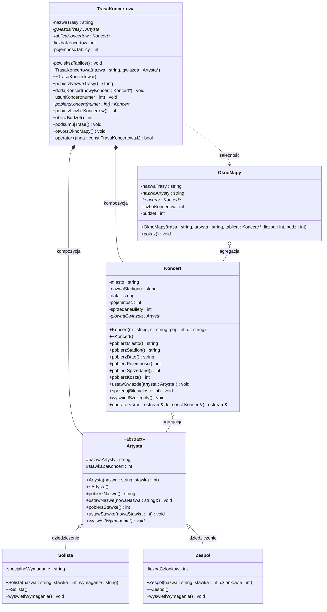

# Menedżer Trasy Koncertowej (Symulator Agencji)

Projekt to aplikacja w C++, która symuluje działanie agencji koncertowej. Pozwala wcielić się w menedżera – tworzyć trasy dla różnych wykonawców, organizować koncerty na konkretnych stadionach, sprzedawać bilety, na bieżąco zarządzać budżetem, a na koniec podejrzeć całą trasę na interaktywnej mapie świata w oknie graficznym `raylib`.

## Jak to jest zbudowane?

Projekt jest podzielony na osobne pliki nagłówkowe (`.h`) i źródłowe (`.cpp`) i opiera się na 6 klasach, które ze sobą współpracują:

- **Artysta, Solista i Zespol (Dziedziczenie i polimorfizm)**
  Zamiast jednego „ogólnego” artysty stworzyłam klasę abstrakcyjną `Artysta` z polami chronionymi (`nazwaArtysty`, `stawkaZaKoncert`), wirtualnym destruktorem oraz czysto wirtualną metodą `wyswietlWymagania()`. Dziedziczą po niej dwie konkretne klasy: `Solista` (który ma swoje specjalne wymagania) oraz `Zespol` (który ma określoną liczbę członków). Dzięki polimorfizmowi i wywołaniom przez wskaźnik `Artysta*` program sam wie, jak wyświetlić dane dla konkretnego typu gwiazdy.

- **Koncert (Przeciążanie operatorów i wyjątki)**
  Klasa reprezentująca pojedyncze wydarzenie. Przechowuje miasto, nazwę stadionu, datę, pojemność, liczbę sprzedanych biletów i wskaźnik na przypisanego artystę.
  Dodałam tutaj własne przeciążenie operatora `<<`, dzięki czemu wypisywanie informacji o koncercie w konsoli jest bardzo proste i czytelne. Zabezpieczyłam też sprzedaż biletów – jeśli ktoś spróbuje sprzedać więcej biletów, niż wynosi pojemność stadionu, program rzuca wyjątek (`throw`), a blok `try`/`catch` informuje o braku miejsc, nie pozwalając na błąd w obliczeniach.

- **TrasaKoncertowa (Zarządzanie pamięcią, tablice dynamiczne i operator `<`)**
  Główny silnik trasy. Zarządza wszystkimi koncertami danego artysty przy pomocy dynamicznej tablicy wskaźników (`Koncert**`). Tablica sama się powiększa (alokując nową pamięć za pomocą `new`), gdy brakuje miejsca na kolejne miasta, a także pozwala na usuwanie odwołanych koncertów z przesuwaniem pozostałych elementów. W destruktorze wszystko jest czyszczone za pomocą `delete` i `delete[]`, aby nie było wycieków pamięci. Dodałam tu również przeciążenie operatora `<`, które porównuje budżety tras i pozwala w raporcie agencji wskazać najdroższą z nich.

- **OknoMapy (Wizualizacja w `raylib` i współrzędne miast)**
  Klasa odpowiadająca za graficzny podgląd trasy. Na początku może wyświetlić plakat trasy (np. `bts.png` lub `jennie.png`), a po przejściu na mapę rysuje mapę świata (`mapa.png`), łączy miasta liniami i animuje przelot samolotu. Współrzędne miast są pobierane przez PowerShella z Open-Meteo Geocoding API (w razie braku internetu program korzysta ze współrzędnych zapasowych). W oknie mapy można pauzować i restartować lot, klikać konkretne przystanki oraz szybko sprzedawać bilety przyciskiem `+1000 BILETOW`.

## Schemat klas UML



## Obsługa programu

Całość obsługuje się przez interaktywne menu w funkcji `main` (pętla `do-while` ze `switch`). Możesz utworzyć nową trasę i przypisać do niej głównego artystę, przełączać się między trasami, dodawać miasta (najlepiej wpisywać je po angielsku, np. `Warsaw`, `London`, `Tokyo`, `New York`), sprzedawać bilety, odwoływać koncerty, wygenerować raport finansowy dla całej agencji ze wskazaniem najdroższej trasy oraz otworzyć okno mapy.

**Wymagania, kompilacja i uruchomienie:**
Do uruchomienia programu potrzebny jest kompilator `g++` (np. MSYS2/MinGW-w64) z biblioteką `raylib` oraz pliki graficzne `mapa.png`, `bts.png` i `jennie.png` w katalogu roboczym. Pobieranie współrzędnych miast korzysta z Open-Meteo API przez Windows PowerShell (wymagany dostęp do internetu).

```bash
g++ main.cpp Artysta.cpp Solista.cpp Zespol.cpp Koncert.cpp TrasaKoncertowa.cpp OknoMapy.cpp -o program.exe -lraylib -lgdi32 -lwinmm
.\program.exe
```
## Przykłady działania programu

**1. Utworzenie trasy, dodanie koncertów i podsumowanie (opcje `1`, `3`, `4`):**
Po utworzeniu trasy `BTS ARIRANG WORLD TOUR` dla zespołu `BTS` (stawka `500000` EUR, `7` członków) i dodaniu dwóch koncertów (`Seoul`, `Brussels`), opcja `4` wyświetla plan trasy (z użyciem przeciążonego operatora `<<` oraz polimorficznej metody `wyswietlWymagania()`) i wylicza całkowity budżet:

```text
=========================================
 TRASA KONCERTOWA: BTS ARIRANG WORLD TOUR
 Liczba zaplanowanych koncertow: 2
=========================================

[1] Seoul (Olympic Stadium) | Data: 15.06.2026 | Zajete miejsca: 0 / 50000
Na scenie wystapi:
ZESPOL: BTS | Stawka: 500000 EUR
Liczba czlonkow na scenie: 7 osob

[2] Brussels (King Baudouin Stadium) | Data: 01.07.2026 | Zajete miejsca: 0 / 50000
Na scenie wystapi:
ZESPOL: BTS | Stawka: 500000 EUR
Liczba czlonkow na scenie: 7 osob

>>> CALKOWITA WYCENA TRASY: 1000000 EUR <<<
```

**2. Sprzedaż biletów i obsługa wyjątku przy braku miejsc (opcja `5`):**
Jeśli liczba biletów mieści się w pojemności stadionu, program aktualizuje licznik. Przy próbie przekroczenia pojemności rzuca wyjątek (`throw`), który zostaje obsłużony w bloku `try`/`catch`:

```text
Wybierz numer koncertu z listy: 1
Ile biletow chcesz sprzedac? 60000
Blad operacji: BLAD: Brak miejsc na stadionie!
```

**3. Raport wszystkich tras i wskazanie najdroższej (opcja `7`):**
Gdy w agencji jest więcej niż jedna trasa, program porównuje ich budżety za pomocą przeciążonego operatora `<` i wskazuje najdroższą z nich:

```text
>>> NAJDROZSZA TRASA W AGENCJI: BTS ARIRANG WORLD TOUR (1000000 EUR) <<<
```

**4. Wizualizacja na mapie (opcja `8`):**
Otwiera okno `raylib` z plakatem trasy (jeśli istnieje plik graficzny dla wykonawcy), animacją lotu samolotu między miastami oraz możliwością klikania przystanków i szybkiej sprzedaży biletów przyciskiem `+1000 BILETOW`.